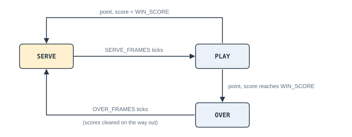

# Chapter 2.1 - Pong

Phase 1 ended with a square that bounced around the screen by itself. This chapter turns that into a game: two paddles moved by the Go Board's buttons, a ball that bounces off walls and paddles, and a score on the 7-segment display. Nothing here needs new hardware. What is new is how much logic a "simple" game takes, how you organize it so it can be tested, and how you find out what it costs on the chip.

## 1. Racing the beam

The Go Board has 8 KB of block RAM, and a 640x480 screen at even one bit per pixel needs 37.5 KB. So there is no picture stored anywhere. Every clock, `vga_timing` tells you which pixel the monitor is drawing, and your logic must answer one question right away: what color is this pixel? The 1972 Pong arcade machine worked the same way, using counters and comparators built from TTL chips, with no processor and no memory for the image.

From this phase on, every Go Board design draws at **320x240 logical pixels**, and each logical pixel covers a 2x2 block of real pixels. Halving the resolution makes objects big enough to see and keeps the coordinates small (9 bits for x, 8 for y). The conversion costs nothing in hardware: drop the low bit.

```verilog
wire [9:0] lx = {1'b0, i_x[9:1]};   // 0..319 across the visible area
wire [9:0] ly = {1'b0, i_y[9:1]};   // 0..239
```

## 2. Per-pixel comparators

"Is this pixel inside the ball?" is four comparisons against the ball's top-left corner `(bx, by)` and its size:

```verilog
wire in_ball = (lx >= bx) && (lx < bx + BALL) &&
               (ly >= by) && (ly < by + BALL);
```

Every object on screen is a test like this, and they all run in parallel every clock. The pixel's color is a **priority** choice among the tests that are true: the first match in an `if / else if` chain wins. Pong needs three objects:

| Object | Shape (logical pixels) | Color (r, g, b) |
| --- | --- | --- |
| Ball | `BALL` x `BALL` square at `(ball_x, ball_y)` | yellow (7, 7, 0) |
| Paddles | `PAD_W` x `PAD_H`, at x = `PAD_L_X` and x = `PAD_R_X`, top at `lpad_y` / `rpad_y` | white (7, 7, 7) |
| Net | x = `W/2 - 1` and `W/2` (columns 159, 160), dashes 8 pixels long with 8-pixel gaps, starting with a dash at y = 0 | grey (3, 3, 3) |

The ball is drawn over the paddles, and the paddles over the net. Everything else is black, and so is every pixel while `de` is low. The net's dashes come from one bit of `ly`: with 8-pixel dashes and gaps, bit 3 is 0 during a dash.

Use half-open ranges everywhere (`>= start`, `< start + size`). A shape that starts at `y` and is `PAD_H` tall covers rows `y` to `y + PAD_H - 1`. Writing `<=` instead draws one extra row or column, which is exactly the kind of error a frame dump catches and your eye does not.

A comparator against a constant is nearly free: yosys folds it into a few LUTs. A comparator against a register, such as `lx < bx + BALL`, needs an adder and a magnitude compare, which on the iCE40 means a carry chain about as long as the operands are wide. Keep that in mind when you read the resource report below.

## 3. Splitting the design

The rule from Chapter 1.3 still holds: game logic runs once per frame, pixel logic runs every clock. This time make them separate modules so each can be tested on its own:

- **`pong_game`** holds every register of the game: ball position and direction, paddle positions, scores and the state machine. It changes only on a one-clock `i_tick` pulse.
- **`pong_render`** is purely combinational. Given the beam position and the positions from `pong_game`, it returns a color.
- **`top_goboard`** wires them to `vga_timing`, the buttons, the display and the pins. It makes the tick at the start of vertical blanking, `x == 0 && y == 480`, so positions never change while the picture is drawn.

Because `pong_game` takes `i_tick` as an input instead of watching `x` and `y` itself, a testbench can pulse the tick every few clocks and play thousands of frames in about a second.

## 4. The rules

A game is only testable when its rules are exact. The testbench checks every one of these, tick by tick, so read them as a specification. All values are logical pixels, and "the ball" means its top-left corner `(bx, by)`.

**Paddles.** On each tick, a paddle whose up button is held (and down is not) moves up by `PAD_SPEED`. A paddle whose down button is held moves down. If the step would reach or pass the screen edge, the paddle stops exactly at the edge: y = 0 at the top, y = `H - PAD_H` at the bottom. With both or neither held, it stays put. Paddles move in every state.

**Walls.** The ball moves `BALL_DY` vertically per tick. Moving up, if `by <= BALL_DY` it lands on y = 0 and turns down. Moving down, if `by + BALL + BALL_DY >= H` it lands on y = `H - BALL` and turns up. This is the same "reach or pass, then clamp" rule as the bouncing square.

**Paddle hits.** The ball moves `BALL_DX` horizontally per tick. The left paddle's hitting face is at x = `L_FACE = PAD_L_X + PAD_W`. A ball moving left hits the paddle when all of these hold:

1. it is still in front of the face, `bx >= L_FACE`;
2. this step would reach or cross the face, `bx - BALL_DX <= L_FACE`;
3. it overlaps the paddle vertically, `by + BALL > lpad_y` and `by < lpad_y + PAD_H` (one row of overlap is enough).

On a hit the ball lands exactly on the face, `bx = L_FACE`, and turns right. The right paddle mirrors this: its face is x = `PAD_R_X`, the ball's right edge is `bx + BALL`, the test is `bx + BALL <= PAD_R_X` and `bx + BALL + BALL_DX >= PAD_R_X`, and a hit puts the ball at `bx = PAD_R_X - BALL`.

Why test the crossing instead of just "is the ball overlapping the paddle"? A ball that moves further per tick than the paddle is wide can jump from in front of the paddle to behind it without ever overlapping it. Games call this **tunneling**. The crossing test cannot miss, at any speed. Condition 1 also means a ball that has already slipped past the face is never "hit" from behind.

**Points.** If a ball moving left does not hit the paddle and `bx <= BALL_DX` (the step reaches the left edge), the right player scores. If a ball moving right misses and `bx + BALL + BALL_DX >= W`, the left player scores. The ball then goes to the centre, `((W - BALL) / 2, (H - BALL) / 2)`, heading toward the player who lost the point, and moving down.

**Which positions count.** All tests on a tick use the values from before the tick, the ones in the frame the players just saw. In a clocked `always` block with non-blocking assignments this happens naturally: every right-hand side reads the old register values. Vertical and horizontal motion are independent, so a ball can bounce off a paddle and a wall on the same tick.

## 5. The game-state machine

Pong has three states:



- **SERVE**: the ball waits in the centre. After `SERVE_FRAMES` ticks the state becomes PLAY, and the ball first moves on the tick after that. At power-up the game is in SERVE, scores 0-0, ball centred heading right and down, paddles centred at y = `(H - PAD_H) / 2`.
- **PLAY**: the ball moves by the rules above.
- **OVER**: entered instead of SERVE when a point brings a score to `WIN_SCORE`. The ball sits in the centre and the final score stays on the display for `OVER_FRAMES` ticks. On the last of those ticks both scores go back to 0 and the state becomes SERVE, with a fresh `SERVE_FRAMES` wait.

Precisely: if a point is scored on tick k, the ball is centred after tick k, stays there through tick k + `SERVE_FRAMES`, and takes its first step on tick k + `SERVE_FRAMES` + 1. One down-counter shared by SERVE and OVER is enough. Size it for the larger of the two delays (180 needs 8 bits).

Expose the state on `o_state`, coded 0 = SERVE, 1 = PLAY, 2 = OVER.

## 6. Designing for test: the load port

"Bounce off the paddle" is hard to test by playing: you would have to steer the ball into the exact spot. Instead, give `pong_game` a **load port**. While `i_load` is high on a clock edge, the ball position, both direction bits and both paddle positions are set from the `i_load_*` inputs, and the state becomes PLAY. Scores are untouched, and a load takes priority over a tick in the same clock. The board top ties `i_load` to 0, and yosys removes the extra logic.

With it, the testbench can place the ball one step away from a paddle's face, give one tick, and check where it ends up. Ports that exist only so a design can be tested are common in real chips; scan chains and debug registers are larger versions of the same idea.

## 7. The board

Map the four buttons as: Switch 1 = left paddle up, Switch 2 = left paddle down, Switch 3 = right paddle up, Switch 4 = right paddle down. Pass each through a `synchronizer`. You do not need `debounce` here: the game only looks at the button level once per frame, and a few milliseconds of contact bounce cannot move a paddle more than one step. Show the left score on digit 1 and the right score on digit 2 with two `hex_to_7seg`s, inverted for the active-low segments. As in Phase 1, register hsync, vsync and the color for one clock before the pins.

On the board, check by hand:

1. The ball waits in the centre for about one second, then moves right and down.
2. Both paddles stop flush at the top and bottom of the screen.
3. The ball bounces off a paddle's very top and very bottom edge, and passes a paddle that is one ball-height away.
4. Missing the ball adds one to the other player's digit, and the next serve goes toward the player who missed.
5. At 9 points the score stays up for about three seconds, then both digits return to 0.
6. All four screen edges look right: the net has a dash at the very top, and nothing tears or flickers.

## 8. Reading the resource report

Build the project and look at the end of the nextpnr log (the `make report` target). For the reference design of this chapter, with the default parameters below, yosys 0.52 and nextpnr-ice40 report:

```
Info: Device utilisation:
Info:          ICESTORM_LC:     640/   1280    50%
Info:         ICESTORM_RAM:       0/     16     0%
Info:                SB_IO:      30/    112    26%
Info:                SB_GB:       2/      8    25%
...
Info: Max frequency for clock 'i_Clk$SB_IO_IN_$glb_clk': 80.44 MHz (PASS at 25.00 MHz)
```

An `ICESTORM_LC` is one logic cell: a 4-input LUT, a carry-chain stage and a flip-flop, which can be used together or alone. The `stat` summary at the end of yosys's log splits that up: 383 `SB_LUT4`, 346 `SB_CARRY` and 94 flip-flops (the `SB_DFF*` lines). Notice the carry count. Almost all of it comes from comparisons against registers: every `<` or `>=` on two 10-bit values, and every `+ BALL` or `+ PAD_H` that feeds one, uses a chain of carry stages.

To see which module costs what, synthesize without flattening the hierarchy:

```
yosys -p "synth_ice40 -noflatten -top top_goboard" top_goboard.v <your rtl files>
```

For the reference design that gives about 306 LUTs and 190 carries for `pong_game`, 80 LUTs and 123 carries for `pong_render`, and 29 LUTs for `vga_timing`. These per-module counts add up to more than the flat build, because flattening lets yosys optimize across module boundaries. The game logic, with its collision tests and clamps, is by far the biggest part. A Pong that uses half the chip leaves the other half for text, tiles and sprites, which is why the next chapters keep looking at this report. Your numbers will differ from these; what matters is that you know where yours come from. If you want to shrink yours, try narrower registers (9 bits for x and 8 for y are enough) and sharing one comparator between the two paddles.

## Testbench requirements

Provide in `rtl/common/`:

- **`pong_game.v`**: `pong_game #(W=320, H=240, BALL=4, PAD_W=4, PAD_H=32, PAD_L_X=8, PAD_R_X=308, PAD_SPEED=3, BALL_DX=3, BALL_DY=2, SERVE_FRAMES=60, OVER_FRAMES=180, WIN_SCORE=9)` with ports `i_clk`, `i_tick`, `i_l_up`, `i_l_dn`, `i_r_up`, `i_r_dn`, `i_load`, `i_load_ball_x[9:0]`, `i_load_ball_y[9:0]`, `i_load_left`, `i_load_up`, `i_load_lpad_y[9:0]`, `i_load_rpad_y[9:0]`, `o_ball_x[9:0]`, `o_ball_y[9:0]`, `o_ball_left` (1 = moving left), `o_ball_up` (1 = moving up), `o_lpad_y[9:0]`, `o_rpad_y[9:0]`, `o_score_l[3:0]`, `o_score_r[3:0]`, `o_state[1:0]` (0 SERVE, 1 PLAY, 2 OVER). All outputs come straight from registers with initial values, and follow the rules above.
- **`pong_render.v`**: `pong_render #(W=320, H=240, BALL=4, PAD_W=4, PAD_H=32, PAD_L_X=8, PAD_R_X=308)` with inputs `i_x[9:0]`, `i_y[9:0]`, `i_de` (straight from `vga_timing`, in real 640x480 pixels), `i_ball_x[9:0]`, `i_ball_y[9:0]`, `i_lpad_y[9:0]`, `i_rpad_y[9:0]` (logical coordinates) and combinational outputs `o_red[2:0]`, `o_grn[2:0]`, `o_blu[2:0]`.
- `vga_timing.v` from Chapter 1.1.

Copy from this chapter: `tb_pong_game.v` and `tb_frame_pong.v` to `sim/`, `ref_pong.py` to `sim/py/`. `tb_frame_pong` also uses `sim/frame_dump.v`, `sim/py/ppm.py` and `sim/py/compare.py` from Chapter 1.2.

Run:

- `make sim-tb_pong_game` (add `tb_pong_game` to your test list so `make test` runs it). It tests the default parameters and a second set (a 7-pixel ball step against 2-pixel paddles, first to 3 wins).
- `make frame-pong` (add `FRAME_TESTS += pong` to the top-level Makefile). It writes `build/frame_pong_{start,edges,net,overlap}.ppm` and compares them with `ref_pong.py`'s drawings.

Board project: `projects/2.1-pong/` with `top_goboard.v` as described above.
