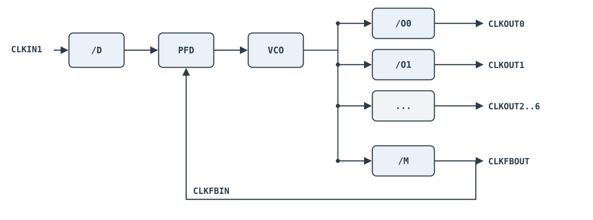
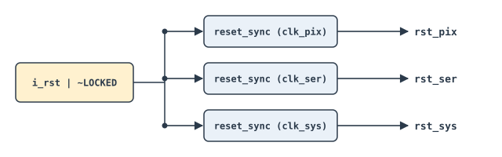

# Chapter 3.2 - Clock Generation

The Go Board's crystal was already a usable pixel clock. The Arty Z7's 125 MHz clock is not: VGA timing needs 25 MHz, Chapter 3.4's HDMI serializer needs a clock five times faster than the pixel clock and locked to it, and Phase 4's drawing engine wants a third speed of its own. Dividing with a counter, as Chapter 3.1 did, gives slow enable pulses, not real clocks. A clock made from flip-flop outputs runs on ordinary routing, with skew and glitches.

The XC7Z020 has hardware for this: four **clock management tiles**, each with an MMCM (mixed-mode clock manager) and a simpler PLL. In this chapter you use one MMCM to turn 125 MHz into three clocks. Then you solve the problem every multi-clock design has: when the clocks are not yet good, everything they drive must wait, and when they become good, each part of the design has to leave reset cleanly.

By the end of this chapter you will have:

- `rtl/common/reset_sync.v`, a reset synchronizer (asynchronous assert, synchronous deassert), portable to any FPGA,
- `rtl/xc7/clk_gen.v`, a wrapper around one `MMCME2_BASE` that gives a 25 MHz pixel clock, a 125 MHz serial clock phase-aligned to it, a 50 MHz system clock, `LOCKED`, and one reset per clock,
- `projects/3.2-arty-clocks/`, where one counter per clock domain blinks an LED, so you can see the ratios between the clocks,
- the book's simulation models of `MMCME2_BASE` and `BUFG`, so Icarus can run Xilinx designs from now on.

## 1. Inside an MMCM

An MMCM is a phase-locked loop with several output dividers:



The **VCO** (voltage-controlled oscillator) runs fast, at hundreds of MHz. The **PFD** (phase-frequency detector) compares the divided input clock with the feedback clock and speeds up or slows down the VCO until the two match exactly. The feedback is the VCO divided by M, so in balance:

  f_VCO = f_in x M / D

and every output is the VCO divided by its own counter:

  f_OUTn = f_VCO / On = f_in x M / (D x On)

All outputs come from the same VCO, so they keep a fixed phase relationship to one another. A 25 MHz output and a 125 MHz output from one MMCM rise together on every 25 MHz edge. This is why Chapter 3.4 can hand data from the pixel clock to a serializer running five times faster.

In the `MMCME2_BASE` primitive, the names are:

| Symbol | Parameter | Range |
| --- | --- | --- |
| D | `DIVCLK_DIVIDE` | 1 to 106 |
| M | `CLKFBOUT_MULT_F` | 2.000 to 64.000, in steps of 0.125 (openXC7's nextpnr accepts at most 63) |
| O0 | `CLKOUT0_DIVIDE_F` | 1, or 2.000 to 128.000 in steps of 0.125 |
| O1 to O6 | `CLKOUT1_DIVIDE` ... `CLKOUT6_DIVIDE` | 1 to 128, integers |

The `_F` names take fractional values. Only output 0 has a fractional divider. The other parameters you need are `CLKIN1_PERIOD`, the input period in ns (8.0 here), and optionally `CLKOUTn_PHASE` and `CLKOUTn_DUTY_CYCLE`. This chapter leaves those at their defaults, 0 degrees and 50%.

### Frequency limits

The divider ranges are not the whole story. Every frequency inside the loop has a legal range, and the ranges depend on the **speed grade**, the `-1` at the end of `xc7z020clg400-1`. The Arty Z7-20 has the slowest grade. From the Zynq-7000 data sheet (DS187), for `-1`:

| Frequency | Formula | Legal range |
| --- | --- | --- |
| Input | f_in | 10 to 800 MHz |
| PFD | f_in / D | 10 to 450 MHz |
| VCO | f_in x M / D | **600 to 1200 MHz** |
| Output | f_VCO / On | up to 800 MHz |

The VCO range is the one that catches people. Online examples are often written for `-2` or `-3` parts, whose VCO goes to 1440 or 1600 MHz.

**nextpnr does not check the VCO range.** With `CLKFBOUT_MULT_F` set to 4.0, which puts the VCO at 500 MHz, the openXC7 flow builds a bitstream without any complaint. The only sign is a log line, `Derived VCO frequency 500.0 MHz`. On the board, such an MMCM may never lock, or may lock only some of the time. The simulation model in this chapter does check, and refuses to lock when the VCO is out of range.

### Choosing values

You need 25, 125 and 50 MHz from 125 MHz. Work backwards from the outputs:

1. **The VCO must be a whole multiple of every output** that uses an integer divider. The least common multiple of 25, 50 and 125 MHz is 250 MHz. In the 600-1200 MHz range, that leaves 750 MHz and 1000 MHz.
2. **Pick M and D to reach it.** With D = 1, the PFD runs at 125 MHz, inside 10-450. Then M = 6 gives 750 MHz and M = 8 gives 1000 MHz. Keep D small: a higher PFD frequency gives a cleaner clock.
3. **Pick the output dividers.** At 1000 MHz: 1000/25 = 40, 1000/125 = 8, 1000/50 = 20. All are integers in range.

Both VCO choices work. When you have a choice, take the higher VCO, which usually gives less jitter. This book uses M = 8, D = 1, and dividers 40, 8 and 20. Which output number carries which clock does not matter, as long as each divider goes with the right clock.

When there is no exact answer, as with 25.175 MHz for strict VGA, you pick the closest frequency the dividers allow, and the fractional `CLKOUT0_DIVIDE_F` helps. Monitors accept 25.000 MHz, so this book never needs that.

### Feedback

`CLKFBOUT` must reach `CLKFBIN`, or the loop has nothing to compare and never locks. The simplest way is a direct wire: `.CLKFBOUT(w_fb), .CLKFBIN(w_fb)`. The outputs are then aligned to each other but not to the clock on pin H16. That is all this book needs, since nothing compares the MMCM outputs with the board clock.

Vivado designs often route the feedback through a `BUFG` as well, so that the outputs line up with the input pin. In openXC7 that has a cost: in a test build, a `BUFG` in the feedback path stopped nextpnr from working out the output frequencies. The log said `Clock net 'clk_pix' has no timing constraint and will be timed at the default 12.00 MHz`, so the timing report meant nothing. Keep the feedback direct.

### `LOCKED`, `RST` and `PWRDWN`

- **`LOCKED`** goes high once the loop has settled, which takes up to 100 µs after configuration or reset. Before that, the outputs may already toggle, but at the wrong frequency, with glitches or runt pulses. **Nothing clocked by an MMCM output may trust its clock until `LOCKED` is high.** `LOCKED` is generated inside the MMCM, so it has no clock relationship with any of the outputs: treat it as asynchronous.
- **`RST`** high stops the outputs and drops `LOCKED`. When it falls, the MMCM locks again from scratch. It needs a pulse of at least 5 ns and needs no synchronizer. This chapter connects it to a button so that you can watch the design lose lock and recover.
- **`PWRDWN`** turns the MMCM off. Tie it to 0.

## 2. Global clock buffers

A clock drives thousands of flip-flops across the whole die, and every flip-flop should see the edge at nearly the same moment. Ordinary routing cannot do that. The XC7Z020 has 32 **global clock buffers** (`BUFG`), each driving a dedicated low-skew network that reaches every clocked element.

Put a `BUFG` between each MMCM output and the logic it clocks:

```verilog
BUFG u_bufg_pix (.I(w_pix), .O(o_clk_pix));
```

If you forget, yosys's `synth_xilinx` inserts one for you on any net that drives clock pins. The log shows them as `$auto$clkbufmap` cells. Writing them out yourself documents the intent and keeps the count under your control. The chip has 32 global buffers; this book's three clocks never come near that budget, but it is a real one in larger designs. The board clock in Chapter 3.1 got its `BUFG` this way automatically; that was the `BUFGCTRL: 1/32` line in the report.

## 3. Resets for generated clocks

Phases 0 to 2 used no resets: every register had an initial value, the chip loaded it during configuration, and the clock was good from the first edge. Generated clocks break that assumption. The flip-flops get their initial values at the end of configuration, when the MMCM has only just started. Between then and `LOCKED`, the clocks can be fast, slow or glitchy, and a state machine clocked by them can wander into any state. The fix is to **hold every domain in reset until `LOCKED` is high**.

### Asynchronous assert, synchronous deassert

The reset that goes to a domain must do two things.

**Assert at once, with or without a clock.** When the MMCM is reset or loses lock, its clocks may stop. A reset that waits for a clock edge might never act. So the reset must assert **asynchronously**. On a 7-series part, `always @(posedge clk or posedge rst)` maps to the `FDPE` (asynchronous preset) and `FDCE` (asynchronous clear) flip-flops. The plain `FDRE` you have used so far has a synchronous reset.

**Release on a clock edge.** Releasing reset is the dangerous moment. A flip-flop leaving reset needs the reset input to be stable for a short window around its clock edge, called recovery and removal time. It is the same idea as setup and hold. `LOCKED` rises at a random point relative to the output clocks. If it releases a domain's flip-flops directly, a release that lands in that window can leave some flip-flops out of reset one cycle earlier than others, or leave one metastable. A counter then starts one step ahead of the state machine that reads it. The release must be **synchronous** to the domain's clock.

A **reset synchronizer** gives you both. It is a short chain of flip-flops, all with an asynchronous preset:

```verilog
always @(posedge i_clk or posedge i_rst)
```

- While `i_rst` is high, every stage is preset to 1 and `o_rst` is 1, immediately, with no clock needed.
- When `i_rst` falls, a 0 shifts into the first stage on each clock edge. `o_rst` falls when the 0 reaches the last stage, which is always just after a clock edge.
- The first stage may go metastable if `i_rst` falls right at an edge. That is why there are at least two stages: the second gives the first a whole clock period to settle. It is the same reasoning as Chapter 0.3's `synchronizer`, which is what this chain becomes if you look only at the release.

Give the registers an initial value of 1, so a domain starts in reset even before anything asserts `i_rst`. Add a `STAGES` parameter (default 2) if you like. Yosys accepts the `(* ASYNC_REG = "TRUE" *)` attribute on the chain; it tells the tools these flip-flops are a synchronizer.

### One reset per domain

A synchronizer can only be synchronous to *one* clock. A reset released on a 25 MHz edge arrives at the 50 MHz and 125 MHz flip-flops at an arbitrary point in their cycles, which is the problem you just solved. So **each clock domain gets its own synchronizer**, all fed by the same asynchronous source:



All three assert together. Each releases two clock edges of its own domain after `LOCKED` rises, so the releases come at slightly different times. That is fine, because nothing in one domain should depend on the exact cycle when another left reset.

### Using the reset inside a domain

`rst_pix` is synchronous to `clk_pix`, so in the pixel domain you can use it either way: `always @(posedge clk_pix or posedge rst_pix)` or a synchronous `if (rst_pix)` inside `always @(posedge clk_pix)`. Both are safe, because the release always comes just after a clock edge. The asynchronous form also clears the domain while its clock is stopped. This chapter's counters use it. Xilinx often recommends synchronous resets for logic that maps into DSP or block RAM pipelines, which matters from Phase 4 on.

Your Phase 0 to 2 modules have no reset ports. Chapter 3.5 decides how they start when it moves them onto `clk_pix`.

## 4. A note on clock domain crossing

You now have three clock domains. Any signal that goes from one to another crosses a clock domain, and the rules from Chapter 0.3 apply, now between your own clocks:

- **A single bit** (a flag, a button) goes through a two-flip-flop synchronizer in the receiving domain.
- **A multi-bit value** cannot simply be synchronized bit by bit, since the bits may arrive on different edges. Use a handshake, a dual-clock FIFO, or a true dual-port block RAM with one port in each domain. Phase 4's framebuffer is the last: the 50 MHz drawing engine writes one port while the 25 MHz scanout reads the other.
- **Clocks from the same MMCM are related.** `clk_ser` is exactly 5 x `clk_pix` and aligned to it, so the timing tools can check paths between them like ordinary paths. Chapter 3.4's `OSERDESE2` relies on that: it takes 10-bit words on `clk_pix` and shifts them out on `clk_ser`. `clk_sys` is related too, but treat the pixel and system domains as unrelated anyway and cross between them only through RAM or synchronizers. Then the drawing engine's clock can change later without breaking anything.

The reset synchronizer is itself a small crossing: `LOCKED` is asynchronous, and each `reset_sync` brings it into one domain.

## 5. The design

### `rtl/common/reset_sync.v`

```verilog
module reset_sync (
    input  wire i_clk,
    input  wire i_rst,   // asynchronous, active high
    output wire o_rst    // active high: asserts at once, releases on i_clk
);
```

A `STAGES` parameter is optional. The testbench uses the default, which must give two to four stages. The module uses no Xilinx primitives, so it goes in `rtl/common/`.

### `rtl/xc7/clk_gen.v`

`clk_gen` instantiates `MMCME2_BASE` and `BUFG`, which exist only on Xilinx parts. Keep it out of `rtl/common/`, so that it is obvious which code is portable. Put it in a new directory, `rtl/xc7/`:

```verilog
module clk_gen (
    input  wire i_clk,      // 125 MHz board clock
    input  wire i_rst,      // asynchronous, active high: resets the MMCM
    output wire o_clk_pix,  // 25 MHz
    output wire o_clk_ser,  // 125 MHz, rising with every o_clk_pix rising edge
    output wire o_clk_sys,  // 50 MHz
    output wire o_locked,   // MMCM LOCKED
    output wire o_rst_pix,  // reset for each domain, active high,
    output wire o_rst_ser,  //   asserted while o_locked is low or i_rst is high,
    output wire o_rst_sys   //   released on that domain's own clock
);
```

Inside, connect:

- `MMCME2_BASE` with `CLKIN1_PERIOD`, `DIVCLK_DIVIDE`, `CLKFBOUT_MULT_F` and three output dividers set to the values from Section 1. Its ports are `CLKIN1`, `CLKFBIN`, `RST`, `PWRDWN` (inputs) and `CLKOUT0` to `CLKOUT6`, `CLKOUT0B` to `CLKOUT3B`, `CLKFBOUT`, `CLKFBOUTB`, `LOCKED` (outputs). Unused outputs can be left unconnected.
- `CLKFBOUT` straight to `CLKFBIN`.
- `i_rst` to `RST`, `1'b0` to `PWRDWN`.
- a `BUFG` on each of the three outputs you use.
- three `reset_sync`s, each clocked by its buffered clock, all with their `i_rst` input driven by `i_rst | ~LOCKED`. Since `RST` already drops `LOCKED`, `~LOCKED` alone also works.

Expect yosys to print `Warning: Replacing floating point parameter u_mmcm.CLKFBOUT_MULT_F = 8.000000 with string` for each real-valued parameter. It is harmless: yosys passes the value on to nextpnr as text.

### `projects/3.2-arty-clocks/top_artyz7.v`

The top uses the same ports as Chapter 3.1 and the same board `.xdc`. It instantiates `clk_gen` with `clk` as the input and `btn[0]` as `i_rst`. In each domain, one counter toggles an LED every **62,500,000 clocks of that domain**, held at zero while the domain's reset is high:

| LED | Domain | Toggles every | Blinks per minute |
| --- | --- | --- | --- |
| `led[0]` | `clk_ser`, 125 MHz | 0.5 s | 60 |
| `led[1]` | `clk_sys`, 50 MHz | 1.25 s | 24 |
| `led[2]` | `clk_pix`, 25 MHz | 2.5 s | 12 |
| `led[3]` | `o_locked` | | stays lit |

All three counters leave reset together after lock, so every 2.5 seconds all three LEDs switch at the same instant, and every 5 seconds all three go dark together. Drive the RGB LEDs to 0, as before, or show something on them such as `rst_pix` on `led4_r`.

You can write the three counters as three `always` blocks in the top, or as one small module with a reset port in the project directory. Do not reuse `blinker` here: it has no reset, so it would count during the unlocked start-up.

### Makefile and the simulation hooks

```make
PROJ  := arty_clocks
TOP   := top_artyz7
include ../../mk/config.mk

SRCS  := top_artyz7.v \
         $(ROOT)/rtl/xc7/clk_gen.v \
         $(ROOT)/rtl/common/reset_sync.v

TESTS := tb_clk_gen

include $(ROOT)/mk/artyz7.mk
```

**Never put `sim/MMCME2_BASE.v` or `sim/BUFG.v` in `SRCS`.** Yosys has its own definitions of the real primitives. A behavioral model in the synthesis sources would replace them with something yosys cannot build.

Three small changes outside the project:

- **`mk/sim.mk`:** add `tb_clk_gen_SRCS := $(ROOT)/rtl/xc7/clk_gen.v`, using the per-testbench hook from Chapter 3.1. (If your `RTL_DIRS` already picks up every `rtl/*/` directory, iverilog finds `clk_gen` without it, but the line does no harm.)
- **`mk/sim.mk`:** make sure the iverilog command has `-y $(ROOT)/sim`. Chapter 1.2's `frame_dump` relies on it, so it is probably there already. That is how Icarus finds the primitive models.
- **`mk/artyz7.mk`:** the `report` target prints only the last `Max frequency` line, which was enough with one clock. Change its `tail -n 1` to `tail -n 3` to see all three clocks.

`make lint` runs Verilator on `SRCS`, and Verilator does not know `MMCME2_BASE` or `BUFG`. It will stop with an unknown-module error until you give it definitions, for example by adding `-y $(ROOT)/sim` to the lint command line. The book's models use delays and real numbers, which Verilator may warn about. Lint `reset_sync` on its own if that gets in the way.

## 6. Simulate first

Icarus has no Xilinx primitives, so this chapter supplies two simulation models. Copy them to `sim/`:

- **`BUFG.v`** is a wire.
- **`MMCME2_BASE.v`** measures the period of `CLKIN1`, then produces every output from one time base using f_in x M / (D x On), honoring `CLKOUTn_PHASE` and `CLKOUTn_DUTY_CYCLE`. Like the real part, it starts its outputs before `LOCKED` rises, and `LOCKED` comes 40 to 55 input clocks later, a varying amount. `RST` stops the outputs and drops `LOCKED` at once. It checks the -1 speed grade limits from Section 1. If the VCO, PFD or input frequency is out of range, a divider is out of range, or `CLKFBIN` is not fed from `CLKFBOUT`, it prints why (`MMCME2_BASE ERROR ...: VCO = 500.000 MHz, outside 600-1200 MHz`) and never locks. It does not model jitter or the phase between the input and the outputs.

Both carry the real primitive's names, so iverilog's `-y sim` picks them up whenever a design uses them, from this step on.

Then copy `tb_clk_gen.v` to `sim/` and run `make test`. It has two parts.

**Part 1** tests `reset_sync` on a clock it can stop and start. It checks that `o_rst` is 1 at power-up; that it rises within 0.5 ns of `i_rst`, even with the clock stopped; and that it falls only at a rising clock edge, on the second to fourth edge after `i_rst` falls, never while `i_rst` is high. It does this for 40 pulses of random length and phase.

**Part 2** runs `clk_gen` from a 125 MHz clock through power-up and five `i_rst` pulses. It checks:

- that each domain reset is high at power-up and within 1 ns of `LOCKED` falling or `i_rst` rising, and is never released while `LOCKED` is low, even though the clocks are already running;
- that each reset falls at a rising edge of its own clock, on the second to fourth edge after `LOCKED` rises. A design that releases all three domains from one synchronizer fails here;
- that the clock periods are 40, 8 and 20 ns with 50% duty while locked, and that `clk_ser` rises at every `clk_pix` rising edge;
- that `LOCKED` falls during each `i_rst` pulse, comes back after it, and never falls otherwise.

It does not check your parameter values, only the clocks they produce. M = 6 with dividers 30, 6 and 15 passes as well as M = 8. The test does not cover the top level: the LED counters are checked on the board.

## 7. Build and read the report

Run `make` in `projects/3.2-arty-clocks/`. The reference design builds in about 8 seconds:

```
== arty_clocks: resource use (xc7z020clg400-1) ==
  SLICE_LUTX:     238/ 106400     0%
  SLICE_FFX:      87/ 106400     0%
  CARRY4:      24/  13300     0%
  PAD:      17/    392     4%
  IOB33_OUTBUF:      10/    200     5%
  IOB33_INBUF_EN:       7/    200     3%
  BUFGCTRL:       3/     32     9%
  MMCME2_ADV:       1/      4    25%
  Max frequency for clock 'clk_sys': 230.57 MHz (PASS at 50.00 MHz)
  Max frequency for clock 'clk_pix': 227.74 MHz (PASS at 25.00 MHz)
  Max frequency for clock 'clk_ser': 245.46 MHz (PASS at 125.00 MHz)
```

How to read it:

- **`MMCME2_ADV` 1 of 4.** There is one MMCM per clock management tile. `MMCME2_BASE` is a simplified view of the full `MMCME2_ADV`, and nextpnr turns one into the other, so the report counts `MMCME2_ADV`.
- **`BUFGCTRL` 3.** One per generated clock. The board clock now feeds only the MMCM, over a dedicated clock path, so it needs no `BUFG` of its own.
- **`SLICE_FFX` 87.** Three 26-bit counters and three LED registers (81), plus three two-stage reset synchronizers (6). Yosys's log shows them as 81 `FDCE` (asynchronous clear: the counters) and 6 `FDPE` (asynchronous preset: the synchronizers, which reset to 1).
- **One `Max frequency` line per clock**, each checked against its own target. nextpnr worked out those targets itself from the MMCM. Look for these lines near the top of `build/nextpnr.log`:

  ```
  Info:     Derived VCO frequency 1000.0 MHz for PLL 'u_clk.u_mmcm'
  Info:     Derived frequency constraint of 125.0 MHz for net clk_ser
  Info:     Derived frequency constraint of 25.0 MHz for net clk_pix
  Info:     Derived frequency constraint of 50.0 MHz for net clk_sys
  ```

  The `.xdc` still has only the one `create_clock`, for the 125 MHz input. **Check the VCO line on every build that changes the MMCM**, since this is where an out-of-range VCO would show up, and nextpnr will not stop on it. If you see `has no timing constraint and will be timed at the default 12.00 MHz` instead, nextpnr could not trace the clock back through the MMCM (Section 1, Feedback).

## 8. On the board

1. In `projects/3.2-arty-clocks/`, run `make prog`.
2. **LOCKED check.** `led[3]` lights at once and stays lit. If it never lights, the MMCM is not locking: check the VCO line in the log, the feedback connection, and that `RST` is not held high.
3. **Ratio check.** Watch the other three LEDs for a minute with a stopwatch. `led[0]` blinks 60 times, `led[1]` 24 times, `led[2]` 12 times. Every 5 seconds all three go dark at the same instant. If the counts are off by a factor, a divider went to the wrong output. If one LED blinks at the board clock's rate, its counter is clocked by `clk` instead of a generated clock.
4. **Reset check.** Hold `btn[0]`. `led[3]` goes out, and the three blink LEDs go dark and stay dark: the MMCM is in reset, its clocks have stopped, and every domain is held in reset. Release it. `led[3]` relights at once (lock takes microseconds), and the three LEDs start again in step: they first light 0.5 s, 1.25 s and 2.5 s after the release.

**Done when:** `led[3]` (LOCKED) stays lit, and the three domain LEDs blink 60, 24 and 12 times a minute, starting again in step after every press of `btn[0]`.

## Testbench requirements

**Modules you provide:**

- `rtl/common/reset_sync.v`: `reset_sync(i_clk, i_rst, o_rst)`, an optional `STAGES` parameter allowed.
  - `o_rst` is 1 from time 0 (initial value), before any clock edge.
  - `i_rst` high sets `o_rst` to 1 within 0.5 ns, with or without a clock.
  - `o_rst` falls only at a rising edge of `i_clk`, on the 2nd to 4th edge after `i_rst` falls, and never while `i_rst` is high. No `x` or `z`.
- `rtl/xc7/clk_gen.v`: `clk_gen(i_clk, i_rst, o_clk_pix, o_clk_ser, o_clk_sys, o_locked, o_rst_pix, o_rst_ser, o_rst_sys)`, built on one `MMCME2_BASE` (any legal parameters) and `BUFG`s.
  - With a 125 MHz `i_clk`: periods of 40 ns (`o_clk_pix`), 8 ns (`o_clk_ser`) and 20 ns (`o_clk_sys`), within 10 ps and 45-55% duty, while `o_locked` is high. Every `o_clk_pix` rising edge coincides with an `o_clk_ser` rising edge.
  - `o_locked` comes from the MMCM's `LOCKED`, is 0 before the input clock starts, and falls during every `i_rst` pulse (40 to 200 ns long), so `i_rst` must reset the MMCM.
  - Each `o_rst_*` is 1 at power-up and within 1 ns of `o_locked` falling or `i_rst` rising. It never falls while `o_locked` is low or `i_rst` is high. It falls at a rising edge of its own clock, on the 2nd to 4th edge after `o_locked` rises, and does not rise again until the next unlock or `i_rst`.

**Files from this chapter:** copy `MMCME2_BASE.v`, `BUFG.v` and `tb_clk_gen.v` to `sim/`. In `mk/sim.mk`, set `tb_clk_gen_SRCS := $(ROOT)/rtl/xc7/clk_gen.v` and make sure the iverilog line has `-y $(ROOT)/sim` (Section 5).

**Testbench:** `sim/tb_clk_gen.v`, top module `tb_clk_gen`. It runs in under a second and prints one `PASS` or `FAIL` line; if the MMCM never locks, the `MMCME2_BASE ERROR` lines above it say why. `+vcd` writes `tb_clk_gen.vcd`. Without the Makefiles:

```sh
mkdir -p build/sim
iverilog -g2012 -Wall -Wno-timescale -y rtl/common -y sim -o build/sim/tb_clk_gen.vvp \
         sim/tb_clk_gen.v rtl/xc7/clk_gen.v
cd build/sim && vvp -n tb_clk_gen.vvp
```
