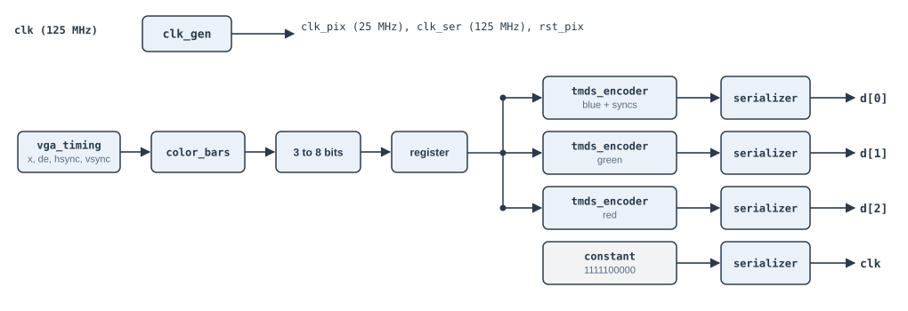

# Chapter 3.4 - HDMI Output

Chapter 3.3 turned a pixel into three 10-bit TMDS symbols per clock. This chapter puts them on the wire. Each symbol has to leave the chip one bit at a time, 250 million bits per second per channel, on a differential pair. No fabric flip-flop can do that reliably, so the 7-series I/O tiles have dedicated serializers, `OSERDESE2`, and differential output buffers, `OBUFDS`. With those, Chapter 1.1's timing generator and color bars appear on an HDMI monitor.

By the end of this chapter you will have:

- `rtl/xc7/tmds_serializer.v`: one TMDS lane, a 10:1 `OSERDESE2` master and slave pair with an `OBUFDS`,
- `rtl/xc7/hdmi_tx.v`: three `tmds_encoder`s and four serializers, the DVI transmitter Chapter 3.5 reuses,
- `projects/3.4-hdmi-bars/`: `clk_gen`, `vga_timing`, `color_bars` and `hdmi_tx` on the Arty Z7's HDMI OUT port,
- `sim/tb_hdmi.v` passing: it receives your four TMDS pairs the way a monitor does and checks the decoded video, and
- color bars on a real monitor, which reports 640x480 at 60 Hz.



## 1. The serializer: `OSERDESE2`

### 10 bits per pixel clock

Every pixel clock, each TMDS channel sends one 10-bit symbol. At 25 MHz that is 250 Mbit/s, a bit every 4 ns. You could clock a shift register at 250 MHz in the fabric, but the slowest Zynq speed grade struggles there, and the path from the last flip-flop to the pin would add a different delay to each lane.

An `OSERDESE2` (output serializer/deserializer) sits in the I/O tile, right next to the pad. It takes a parallel word on a slow clock, `CLKDIV`, and shifts it out on a fast clock, `CLK`. In **DDR** mode it sends a bit on both edges of `CLK`, so a 10-bit word needs only five `CLK` cycles:

| Clock | Port | Frequency | Role |
| --- | --- | --- | --- |
| `clk_pix` | `CLKDIV` | 25 MHz | takes one 10-bit word per rising edge |
| `clk_ser` | `CLK` | 125 MHz | shifts out 2 bits per cycle (rising and falling edge) |

This is why Chapter 3.2's MMCM makes `clk_ser` exactly 5 x `clk_pix` from the same VCO. The serializer needs the two clocks phase-aligned: each `CLKDIV` rising edge must line up with a `CLK` rising edge. Two clocks from unrelated sources, or a `CLK` that is not exactly five times `CLKDIV`, make it drop or repeat bits.

### Master and slave

One `OSERDESE2` has eight data inputs, `D1` to `D8`, so on its own it serializes at most 8 bits in DDR mode. For 10 or 14 bits, UG471 (the 7-series SelectIO guide) joins two of them:

- the **master** (`SERDES_MODE = "MASTER"`) takes bits 0-7 on `D1`-`D8` and drives the pad through `OQ`;
- the **slave** (`SERDES_MODE = "SLAVE"`) takes bits 8 and 9 on its **`D3` and `D4`**. Its `D1` and `D2` are unused (tie them to 0), and so are `D5`-`D8` at width 10;
- the slave's `SHIFTOUT1` and `SHIFTOUT2` connect to the master's `SHIFTIN1` and `SHIFTIN2`. That is how bits 8 and 9 reach the master's shift register.

Both get the same parameters apart from `SERDES_MODE`:

```verilog
OSERDESE2 #(
    .DATA_RATE_OQ   ("DDR"),
    .DATA_RATE_TQ   ("SDR"),
    .DATA_WIDTH     (10),
    .SERDES_MODE    ("MASTER"),     // "SLAVE" on the other one
    .TRISTATE_WIDTH (1)
) u_master ( ... );
```

and the same connections for the shared signals: `CLK` = `clk_ser`, `CLKDIV` = `clk_pix`, `RST` = the pixel-domain reset, `OCE` = 1. Tie the three-state inputs `T1`-`T4` and `TCE` to 0, and `TBYTEIN` too. Leave the outputs you do not use (`OFB`, `TQ`, `TFB`, `TBYTEOUT`, the master's `SHIFTOUT`s, the slave's `OQ`) unconnected. The master's `OQ` goes to the `OBUFDS`.

Every differential output owns both I/O sites of its pin pair, and each site has its own `OSERDESE2`. The slave has a natural home: nextpnr places it in the site of the pair's N pin, and the master in the site of the P pin, which drives the output.

### Bit order

**`D1` leaves first.** TMDS sends bit 0 of each symbol first (Chapter 3.3), so wire symbol bit 0 to the master's `D1`, bit 7 to its `D8`, bit 8 to the slave's `D3` and bit 9 to its `D4`. Reversing the order is the most common serializer bug. The monitor then sees no valid control symbols and shows nothing.

### Reset after lock

The serializer has its own small state machine: a counter that decides on which `CLK` edge the next word is loaded, and the link between master and slave. UG471 asks for `RST` to be asserted **after `CLK` and `CLKDIV` are stable**, and released **synchronously to `CLKDIV`**, with the master and slave released on the same edge. (`RST` acts at once when it rises; the serializer retimes its release internally.) Otherwise the load point is undefined, and the master and slave can disagree about where a word starts.

You already have exactly that signal. Chapter 3.2's `o_rst_pix` is high until the MMCM locks and falls on a `clk_pix` edge. Connect it to `RST` on both `OSERDESE2`s of every lane. Do not tie `RST` to 0, and do not use a power-up pulse that ends before `LOCKED` rises.

`RST` holds `OQ` at 0, so while the MMCM relocks after a press of `btn[0]`, the HDMI lines are quiet and the monitor shows "no signal" for a moment.

## 2. Differential output: `OBUFDS` and `TMDS_33`

TMDS is differential: each signal travels on a pair, P and N, and the receiver looks at the difference. The `OBUFDS` primitive drives a pair from one internal signal:

```verilog
OBUFDS u_obuf (.I(w_oq), .O(o_p), .OB(o_n));
```

`O` drives the P pin, `OB` the N pin, with the opposite level. The pins of a pair are fixed by the board: on the Zynq, each pair is an `_P`/`_N` ball pair of one I/O tile, and the `.xdc` must name both.

The electrical standard is **`TMDS_33`**. It is not a voltage driver like `LVCMOS33`: it switches a current between the two wires, and the monitor's input provides the termination, a 50 ohm resistor from each wire to 3.3 V. So you cannot check the pins with a meter or a scope probe unless a monitor is connected. `TMDS_33` needs a 3.3 V I/O bank. All the Arty Z7's PL banks are 3.3 V, and the HDMI pins are wired to them.

## 3. The clock channel

The fourth pair carries the pixel clock, 25 MHz, from which the monitor's receiver regenerates the bit clock. Send it through a serializer like the data, with the constant word **`1111100000`**: bit 0 first, that is five 0s, then five 1s, one period per pixel clock. Doing it this way gives the clock exactly the same path to the pins as the data: same `OSERDESE2`, same `OBUFDS`, same delays.

A real receiver does not care about the clock's phase. It finds the symbol boundaries on each data channel from the control symbols (Chapter 3.3, Section 4). The testbench uses the clock's falling edge as its first guess for where a word starts, so with `1111100000` everything lines up at once.

## 4. The HDMI pins

This chapter supplies an updated board file, `arty-z7-20.xdc`. It is Chapter 3.1's file with the HDMI TX lines uncommented, nothing else changed. Copy it over `boards/arty-z7-20/arty-z7-20.xdc`.

| Port | Pin | Port | Pin | TMDS signal |
| --- | --- | --- | --- | --- |
| `hdmi_tx_clk_p` | L16 | `hdmi_tx_clk_n` | L17 | clock |
| `hdmi_tx_d_p[0]` | K17 | `hdmi_tx_d_n[0]` | K18 | channel 0: blue, hsync, vsync |
| `hdmi_tx_d_p[1]` | K19 | `hdmi_tx_d_n[1]` | J19 | channel 1: green |
| `hdmi_tx_d_p[2]` | J18 | `hdmi_tx_d_n[2]` | H18 | channel 2: red |

All eight lines carry `IOSTANDARD TMDS_33`. Use the port on the board labeled **HDMI OUT**. The other HDMI connector is an input.

The file also enables four LVCMOS33 lines that this book never uses: `hdmi_tx_hpdn` (hot-plug detect, an input, active low), `hdmi_tx_cec` and the DDC pair `hdmi_tx_scl`/`hdmi_tx_sda`. DDC is how a source reads the monitor's EDID, its list of supported modes. You can skip it because 640x480 at 60 Hz is the one mode every HDMI display must support, and practically every DVI monitor does too. As with every line in the board file, they are skipped when the design has no such port.

## 5. The design

### `rtl/xc7/tmds_serializer.v`

```verilog
module tmds_serializer (
    input  wire       i_clk_pix,   // CLKDIV
    input  wire       i_clk_ser,   // CLK, 5 x i_clk_pix, phase-aligned
    input  wire       i_rst,       // synchronous to i_clk_pix
    input  wire [9:0] i_data,      // bit 0 is sent first
    output wire       o_p,
    output wire       o_n
);
```

Inside: the master and slave of Section 1 and the `OBUFDS` of Section 2. It uses Xilinx primitives, so it goes in `rtl/xc7/` next to `clk_gen`.

### `rtl/xc7/hdmi_tx.v`

```verilog
module hdmi_tx (
    input  wire       i_clk_pix,
    input  wire       i_clk_ser,
    input  wire       i_rst_pix,
    input  wire       i_de,
    input  wire       i_hsync,
    input  wire       i_vsync,
    input  wire [7:0] i_red,
    input  wire [7:0] i_grn,
    input  wire [7:0] i_blu,
    output wire       o_clk_p,
    output wire       o_clk_n,
    output wire [2:0] o_d_p,
    output wire [2:0] o_d_n
);
```

Three `tmds_encoder`s from Chapter 3.3: channel 0 gets blue with `i_ctrl = {i_vsync, i_hsync}`, channel 1 green and channel 2 red, both with `i_ctrl = 2'b00`. Then four `tmds_serializer`s: one per channel on `o_d_p[n]`/`o_d_n[n]`, and one sending `10'b1111100000` on `o_clk_p`/`o_clk_n`. Chapter 3.5 moves Pong and the tile engine onto this module, so keep board details out of it.

### From 3 bits to 8 bits

`color_bars` gives 3 bits per channel, the encoders want 8. Shifting left (`{c, 5'b0}`) turns full brightness `3'b111` into `8'hE0`, a dim white. **Repeat the bits** instead:

  `c8 = {c3, c3, c3[2:1]}`, so `111` → `1111_1111` and `100` → `1001_0010`

This maps 0 to 0 and 7 to 255 and spaces the values in between almost evenly, at no cost: it is only wiring. Computing `c3 * 255 / 7` rounded to the nearest integer gives the same numbers (Verilog's `/` truncates, so `2` would give 72 instead of 73), but in a test build of this chapter's design yosys turned the three dividers into about 780 extra LUT halves and three DSP slices.

### Keep everything aligned

The monitor receives no separate `de` or sync wires. They travel inside the same symbol stream as the color. So all of them must reach the encoders **on the same pixel clock** as the color of the pixel they belong to. The rule from Chapter 1.1 still holds:

- `vga_timing` outputs `de`, `hsync`, `vsync` aligned with `x` and `y`; `color_bars` and the bit expansion are combinational.
- Register **all of them** in one stage in the top, as the Phase 1 board tops did, then feed the encoders.
- The three encoders are identical, so they add the same latency. The serializers add the same latency on all four lanes.

If you register the color twice and the syncs once, every line shows its first pixel black and loses one at the end; the testbench reports how many clocks apart they are. The total latency does not matter, only that it is the same everywhere.

### `projects/3.4-hdmi-bars/top_artyz7.v`

```verilog
module top_artyz7 #(
    parameter integer V_VISIBLE = 480,
    parameter integer V_FRONT   = 10,
    parameter integer V_SYNC    = 2,
    parameter integer V_BACK    = 33
) (
    input  wire       clk,
    input  wire [3:0] btn,
    output wire [3:0] led,
    output wire       hdmi_tx_clk_p,
    output wire       hdmi_tx_clk_n,
    output wire [2:0] hdmi_tx_d_p,
    output wire [2:0] hdmi_tx_d_n
);
```

It instantiates `clk_gen` (`btn[0]` on `i_rst`, as in Chapter 3.2), `vga_timing` clocked by `clk_pix` with the four `V_` parameters passed through, `color_bars`, the bit expansion, the register stage and `hdmi_tx` with `rst_pix`. Show `locked` on `led[0]`; the other LEDs are free.

The four parameters exist for the testbench only. A full 800x525 frame takes about 17 ms at 250 Mbit/s, several minutes in Icarus, so the test shortens the frame to 15 lines. The board build uses the defaults.

## 6. Makefile and simulation hooks

```make
PROJ  := hdmi_bars
TOP   := top_artyz7
include ../../mk/config.mk

SRCS  := top_artyz7.v \
         $(ROOT)/rtl/xc7/clk_gen.v \
         $(ROOT)/rtl/xc7/hdmi_tx.v \
         $(ROOT)/rtl/xc7/tmds_serializer.v \
         $(ROOT)/rtl/common/reset_sync.v \
         $(ROOT)/rtl/common/vga_timing.v \
         $(ROOT)/rtl/common/color_bars.v \
         $(ROOT)/rtl/common/tmds_encoder.v

TESTS := tb_hdmi tb_tmds tb_clk_gen

include $(ROOT)/mk/artyz7.mk
```

As in Chapter 3.2, **never put the simulation models in `SRCS`**: yosys has the real `OSERDESE2` and `OBUFDS`. In `mk/sim.mk`, add

```make
tb_hdmi_SRCS := $(ROOT)/projects/3.4-hdmi-bars/top_artyz7.v
```

`make lint` needs definitions of `OSERDESE2` and `OBUFDS` for Verilator, the same issue Chapter 3.2 described for `MMCME2_BASE`.

## 7. Simulate

Copy `OSERDESE2.v` and `OBUFDS.v` from this chapter to `sim/`, next to Chapter 3.2's models.

**`OBUFDS.v`** drives `O` with the input and `OB` with its inverse.

**`OSERDESE2.v`** models the DDR modes, with widths 10 and 14 as a master and slave pair. It shifts bits out in silicon's order (master `D1` first ... `D8`, then the slave's `D3`, `D4`), takes words on `CLKDIV` and moves bits on both `CLK` edges, and passes the slave's bits through `SHIFTOUT`/`SHIFTIN` as the hardware does. It is strict where hardware is unforgiving:

- `RST` sets `OQ` to 0 at once; its release is taken on a `CLKDIV` edge;
- `OQ` is X until `RST` has been high at a `CLKDIV` edge while `CLK` runs, the model's version of "reset after the clocks are stable";
- it prints an error and drives X if `CLK` is not `DATA_WIDTH/2` times `CLKDIV`, for example when the two clocks are swapped;
- a slave's `OQ` and a master's `SHIFTOUT`s are X, since they carry nothing useful on the chip, so a swapped master and slave shows up at once.

Its latency (a word starts on the first `CLK` edge after the `CLKDIV` edge that took it) is not silicon's, and nothing should depend on it.

Copy `tb_hdmi.v` to `sim/` and run `make test`. It drives the 125 MHz board clock into your top, so your `clk_gen` and the MMCM model are part of the test, and watches only the four pairs:

1. It waits for the clock pair to run with a steady 40 ns period, then samples all four lanes in the middle of every bit, and checks that every N pin is the inverse of its P pin.
2. It cuts the stream into words at the clock pair's falling edge and checks that every clock word is `1111100000`.
3. It finds where the data words start, from the control symbols as a monitor does, and decodes them with its own TMDS decoder. Every data symbol must be exactly the DVI 1.0 code of its byte, and all three channels must switch between data and control in the same clock.
4. It compares two whole frames, clock by clock, with the expected video: `de`, hsync and vsync from channel 0's control bits, 00 on the others, and the eight bars as `8'hFF`/`8'h00` on red (channel 2), green (1) and blue (0). The frame is lined up on the first vsync, so any pipeline latency passes. Lines keep their real timing (800 clocks, 640 visible); only the number of lines is reduced.
5. It holds `btn[0]` for 200 ns, checks that the clock pair stops, and checks that correct video comes back after the MMCM relocks.

It takes about 20 seconds. The messages name the usual mistakes: X on the pins (`RST` never asserted, clocks swapped, the pin driven by the slave), X in bits 8 and 9 or a clock word with only three 1s (the slave or its `SHIFTOUT` wiring), reversed bit order, syncs on the wrong channel or swapped, colors a few clocks off from `de`, `8'hE0` instead of `8'hFF`, red and blue swapped.

**If simulations feel slow**, the cause is the MMCM model. It generates every output, and `CLKOUT3`-`CLKOUT6`, which `clk_gen` leaves at their default divider of 1, run at the 1 GHz VCO frequency in simulation. Setting those four dividers to 128 in `clk_gen` changes nothing on the chip, since unused outputs are not connected, and makes `tb_hdmi` about 2.5 times faster. `tb_clk_gen` still passes, because it accepts any legal parameters.

## 8. Build and read the report

Run `make` in `projects/3.4-hdmi-bars/`. The reference design builds in about 8 seconds:

```
== hdmi_bars: resource use (xc7z020clg400-1) ==
  SLICE_LUTX:     154/ 106400     0%
  SLICE_FFX:      64/ 106400     0%
  CARRY4:      13/  13300     0%
  PAD:      17/    392     4%
  IOB33M_OUTBUF:       4/     96     4%
  IOB33S_OUTBUF:       4/     96     4%
  IOB33_OUTBUF:       4/    200     2%
  IOB33_INBUF_EN:       5/    200     2%
  OSERDESE2:       8/    200     4%
  BUFGCTRL:       2/     32     6%
  INVERTER:       4/     96     4%
  MMCME2_ADV:       1/      4    25%
  Max frequency for clock 'clk_pix': 290.78 MHz (PASS at 25.00 MHz)
```

How to read it:

- **`OSERDESE2` 8**: a master and a slave for each of the four lanes.
- **`IOB33M_OUTBUF` 4, `IOB33S_OUTBUF` 4, `INVERTER` 4**: nextpnr builds each `OBUFDS` from both I/O sites of its pair, the M site (P pin) and the S site (N pin), the latter with an inverted copy of the signal. `grep TMDS_33 build/hdmi_bars.fasm` shows `TMDS_33.OUT` features in the four HDMI I/O tiles, which is how you can see that the `.xdc` standard reached the bitstream. `IOB33_OUTBUF` 4 are the LEDs, and `PAD` 17 counts the clock, four buttons, four LEDs and eight HDMI pins.
- **`BUFGCTRL` 2**: `clk_pix` and `clk_ser`. `clk_sys` is unused, so yosys removed its buffer.
- **Only `clk_pix` has a timing line.** `clk_ser` drives only the serializers' `CLK` pins and no fabric flip-flops, so nextpnr has no register-to-register path to report for it. Since Chapter 3.2 changed the report to `tail -n 3`, you may see the `clk_pix` line up to three times, from different stages of the run. The last one is the final result, around 290 MHz. In the log you should still find `Derived VCO frequency 1000.0 MHz` and `Derived frequency constraint of 125.0 MHz for net clk_ser`.
- **Small encoders.** Yosys counts only 53 LUTs and 64 flip-flops for the whole design, far less than three times the 56 LUTs per encoder from Chapter 3.3. Color bars only ever send `8'h00` or `8'hFF`, and yosys simplifies the encoders for those two values. Chapter 3.5's games will use the full logic.

nextpnr places the serializers itself, master and slave in the two sites of each pair's I/O tile, with `SHIFTOUT` wired over the tile's dedicated cascade path. (The FASM marks the slaves with `OSERDES.SERDES_MODE.SLAVE`.)

## 9. On the board

1. Connect a monitor to the **HDMI OUT** port with an HDMI cable, or an HDMI-to-DVI cable. Turn the monitor on and select that input.
2. In `projects/3.4-hdmi-bars/`, run `make prog`. `led[0]` (LOCKED) lights.
3. **Picture check.** Eight vertical bars fill the screen, left to right: white, yellow, cyan, green, magenta, red, blue, black. They should be full brightness with sharp edges, and nothing should show in the borders.
4. **Mode check.** Open the monitor's on-screen menu and find its input or information page. It should report **640x480 at 60 Hz**. Some monitors show 59 or 59.5 Hz: with a 25.000 MHz pixel clock instead of the standard 25.175 MHz, the frame rate is 25,000,000 / (800 x 525) = 59.5 Hz, and the line rate 31.25 kHz. Monitors accept it. If it reports another mode, the `V_` defaults or the `clk_gen` dividers are wrong.
5. **Reset check.** Press and release `btn[0]`. The picture drops out briefly, perhaps with a "no signal" message, and comes back.

**If the colors are wrong** but the picture is stable, check the channel mapping (red on channel 2, green on 1, blue on 0) and the bit expansion. **If the image is shifted or the edges are smeared**, compare the latency of color and syncs, then run the testbench again. **If the monitor reports a signal but shows nothing** or a scrambled picture, suspect the bit order.

**If the monitor shows nothing at all**, do these in order:

- Run `tb_hdmi` again. A design that passes it has the right bits on the right pins in the right order.
- Check that `led[0]` is lit (the MMCM locked) and that the `.xdc` HDMI lines are uncommented. A port without a `PACKAGE_PIN` stops nextpnr, but a wrong pin number does not.
- Try another cable and another monitor. HDMI-to-DVI adapters and some TVs are picky, and a plain computer monitor is the best test.
- **Cross-check with Vivado.** Build the same Verilog (your RTL, not the `sim/` models) with the same `.xdc` in Vivado once. The free edition supports the XC7Z020, and it accepts the brace-safe `.xdc`. Load its `.bit` with `openFPGALoader` as usual. If Vivado's bitstream shows the bars and openXC7's does not, the problem is in the open-source flow (the `OSERDESE2` or `TMDS_33` configuration in the bitstream), not in your design. Report it to the openXC7 project with your design. If neither works, the problem is in your design or the hardware setup.

**Done when:** `tb_hdmi` prints `PASS`, the monitor shows the eight color bars, and its information menu reports 640x480 at 60 Hz.

## Testbench requirements

**Modules you provide:**

- `projects/3.4-hdmi-bars/top_artyz7.v`: `top_artyz7 #(V_VISIBLE=480, V_FRONT=10, V_SYNC=2, V_BACK=33)(clk, btn[3:0], led[3:0], hdmi_tx_clk_p, hdmi_tx_clk_n, hdmi_tx_d_p[2:0], hdmi_tx_d_n[2:0])`.
  - From a 125 MHz `clk`, it sends 640-pixel lines (800 clocks per line, `vga_timing`'s horizontal defaults) and the four `V_` parameters' line counts, with the eight bars as `8'hFF`/`8'h00` per channel, as DVI on the four pairs: channel 0 blue with `{C1, C0} = {vsync, hsync}`, channel 1 green and channel 2 red with control bits 00. Every symbol is exact DVI 1.0 TMDS (Chapter 3.3's encoder), sent bit 0 first at 10 bits per pixel clock.
  - The clock pair sends `1111100000` (five 0s, then five 1s) every pixel clock. Data words should start at its falling edge; the test accepts any fixed bit offset, with a note.
  - Each `_n` pin is always the inverse of its `_p` pin. No X or Z once the clock pair runs.
  - Any pipeline latency, as long as `de`, the syncs and the color share it and all channels change symbols in the same clock.
  - `btn[0]` resets the MMCM (`clk_gen`'s `i_rst`): the clock pair stops while it is held, and correct video returns after release within 100 µs. `led` is not checked.
- Below it, your `clk_gen` and `reset_sync` (Chapter 3.2), `vga_timing` and `color_bars` (Chapter 1.1), `tmds_encoder` (Chapter 3.3), and this chapter's `tmds_serializer` and `hdmi_tx`, or any structure of your own that meets the requirements above.

**Files from this chapter:** `OSERDESE2.v`, `OBUFDS.v` and `tb_hdmi.v` to `sim/`. `arty-z7-20.xdc` to `boards/arty-z7-20/arty-z7-20.xdc` (replacing Chapter 3.1's). In `mk/sim.mk`, `tb_hdmi_SRCS := $(ROOT)/projects/3.4-hdmi-bars/top_artyz7.v`.

**Testbench:** `sim/tb_hdmi.v`, top module `tb_hdmi`. It overrides the top's vertical timing to `V_VISIBLE=6, V_FRONT=3, V_SYNC=2, V_BACK=4`, runs in about 20 seconds and prints one `PASS` or `FAIL` line. `+vcd` writes `tb_hdmi.vcd`, which is large. Without the Makefiles:

```sh
mkdir -p build/sim
iverilog -g2012 -Wall -Wno-timescale -y rtl/common -y rtl/xc7 -y sim -o build/sim/tb_hdmi.vvp \
         sim/tb_hdmi.v projects/3.4-hdmi-bars/top_artyz7.v
cd build/sim && vvp -n tb_hdmi.vvp
```
